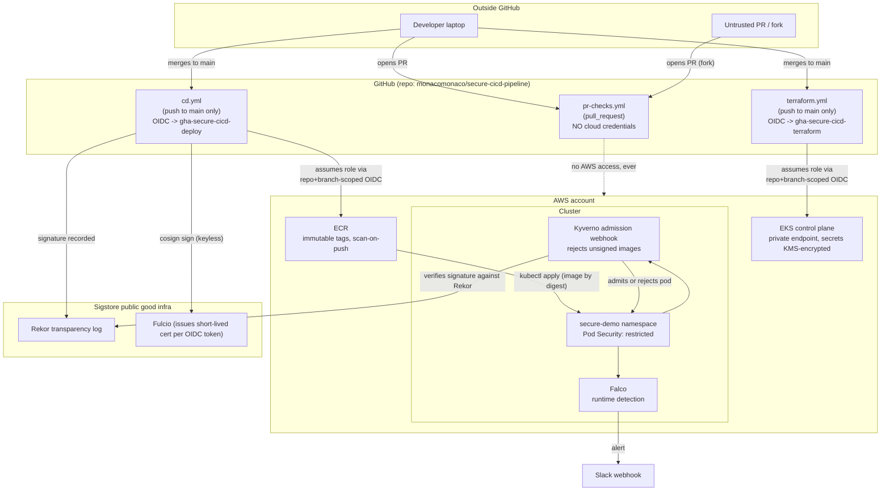

# Security

This document covers two things:

1. **How to report a vulnerability in this repository's pipeline itself** (the standard `SECURITY.md` purpose).
2. **The threat model** the pipeline was designed against — what each control stops, what it doesn't, and the tradeoffs made along the way. This part matters more than the YAML: anyone can wire up five scanners; the point is knowing what each one is actually for.

---

## 1. Reporting a vulnerability

This is a portfolio/demo project, not a production service handling real user data. If you find a flaw in the pipeline design, the Terraform, the Kubernetes manifests, or the workflows — a bypass of a gate, an overly broad IAM permission, a Kyverno policy that doesn't actually enforce what it claims to — please open a GitHub issue, or reach out directly rather than opening a public PR that demonstrates the bypass. There's no bug bounty here; the ask is just "don't weaponize it before I've had a chance to fix it."

---

## 2. Threat model

### 2.1 Scope and non-goals

**In scope:** the software supply chain from `git push` to a running pod — source, dependencies, CI runners, the container image, the registry, the cluster's admission path, and basic runtime detection.

**Explicitly out of scope** (a real production system would need these; this demo doesn't try to solve them):

- Application-layer security of the Flask API itself (authn/authz, input validation beyond what Semgrep catches, rate limiting). The app is a placeholder — see the repo README.
- Network-layer segmentation inside the cluster (no `NetworkPolicy` resources are defined; every pod in the namespace can currently talk to every other pod).
- Multi-tenancy / blast radius between environments — this stack provisions a single demo environment, not a prod/staging split with separate accounts.
- DDoS/availability attacks, WAF, or edge protection — there's no ingress/CDN layer in front of the Service.
- Formal compliance mapping (SOC 2, PCI, FedRAMP). The controls below happen to overlap with several SSDF/SLSA practices, but nothing here has been audited against a framework.
- Falco alert triage/response automation — alerts land in Slack; nothing pages anyone or auto-remediates.

### 2.2 Trust boundaries

The one boundary that matters most: **`pr-checks.yml` never has cloud credentials.** Every other design decision below (branch-restricted OIDC `sub` claims, the split between the deploy role and the terraform role, no `pull_request_target`) exists to preserve that property, because it's the one that determines what an attacker gets from "just open a malicious PR" — which, for a public or semi-public repo, is the cheapest attack available to them.

### 2.3 Attack surface, stage by stage

#### A. Source & PR stage

| Threat | Example | Control | Residual risk |
|---|---|---|---|
| Malicious/vulnerable code merged | SQL/command injection, `eval()` on user input | Semgrep (`pr-checks.yml`, `sast-semgrep`) blocks the PR on findings | Semgrep's ruleset (`auto`) is generic; it won't catch app-specific logic flaws. See `demo/` for a worked example of what it does catch. |
| Hardcoded credentials committed | AWS key, API token, private key pasted into a route handler | Gitleaks (`secrets-gitleaks`) scans full history on the PR diff | Only catches known secret *shapes*; a bespoke internal token format needs a custom Gitleaks rule (not configured here). Doesn't scan history that predates the PR unless you run a one-time full-repo scan. |
| Misconfigured infrastructure merged | EKS API endpoint opened to `0.0.0.0/0`, ECR mutable tags | Checkov (`iac-scan`) hard-fails on HIGH/CRITICAL | Checkov's policy set won't catch a misconfiguration it has no rule for, or one expressed only inside a third-party module's internals. |
| Vulnerable base image / dependency introduced | Old `python:3.12-slim` digest with a patched CVE, a vulnerable pip package | Trivy (`container-scan`) builds and scans the image on every PR | This is a build-time snapshot — a CVE disclosed *after* merge isn't caught until the next PR touches the image (there's no scheduled re-scan of the already-deployed image in this repo; see 2.5). |
| Compromised/malicious PR pretends to be a trusted contributor | Fork PR with a plausible-looking diff | Every PR — trusted or not — gets the same zero-credential treatment | Doesn't stop a malicious PR from *merging* if a human reviewer approves it carelessly. Branch protection + required review is a GitHub repo setting, not something this pipeline can enforce from inside a workflow file. |

#### B. Build & CI stage

| Threat | Example | Control | Residual risk |
|---|---|---|---|
| Stolen long-lived AWS credentials | A leaked `AWS_ACCESS_KEY_ID` secret used outside CI | No long-lived AWS keys exist. `cd.yml`/`terraform.yml` assume roles via OIDC, scoped by `token.actions.githubusercontent.com:sub` to `repo:<org>/<repo>:ref:refs/heads/main` — the token is only mintable *by that workflow, on that branch* and expires in ~1 hour. | The GitHub Actions runner itself, for the duration of one job, holds valid (if short-lived) AWS credentials. A compromised action/dependency running in that job window could still act within the role's permissions — see the CI-as-root problem below. |
| Poisoned Action dependency | A pinned Action (`aquasecurity/trivy-action`, `sigstore/cosign-installer`, etc.) gets compromised upstream | Actions are pinned to specific version tags (not floating `@main`/`@latest`); Dependabot (`.github/dependabot.yml`) surfaces updates for human review rather than auto-pulling | Version *tags* on GitHub Actions are mutable by the upstream maintainer (unlike a commit SHA). For higher assurance, pin to a full commit SHA instead of a tag — not done here, documented as a known gap (2.5). |
| The "CI-as-root problem" | `gha-secure-cicd-terraform` needs broad `ec2:*`/`eks:*`/`iam:CreateRole` permissions to provision a VPC+EKS+IAM stack | (1) Branch-restricted to `main` only — never runs on a PR. (2) A permissions boundary (`ci_permissions_boundary` in `oidc-github.tf`) blocks IAM-user creation, org/billing changes, and role creation outside `/secure-cicd-pipeline/`. (3) `terraform.yml`'s `apply` job requires a GitHub Environment (`infra-apply`) with manual reviewer approval — a passing Checkov scan is necessary, not sufficient. | This role is still, deliberately, powerful. The boundary caps the *ceiling* (can't pivot to full account takeover); it doesn't make a bad `terraform apply` harmless. This is the single most sensitive component in the whole design — treat any change to `oidc-github.tf` as requiring extra scrutiny. |
| Build produces a different artifact than what was reviewed | PR shows clean code; build step injects something extra | The image built and scanned in `cd.yml` is built directly from the merged `main` commit — there's no separate "release" step that could diverge from what was reviewed | Doesn't defend against a compromised GitHub-hosted runner image itself (out of scope — that's GitHub's trust boundary, not this repo's). |

#### C. Registry & signing stage

| Threat | Example | Control | Residual risk |
|---|---|---|---|
| Unsigned or tampered image deployed | Someone with registry push access uploads an image outside the pipeline | Cosign keyless signing (`cd.yml`) binds the signature to *this exact workflow run's* OIDC identity (`.github/workflows/cd.yml@refs/heads/main`); Kyverno (`k8s/kyverno/require-image-signature.yaml`) verifies that identity at admission time, in-cluster, independent of the CI system's say-so | If the deploy role's ECR push permission were compromised, an attacker *could* push an unsigned image — but Kyverno rejects it at admission regardless of how it got into the registry. Signing + admission enforcement together are what make this meaningful; either alone is much weaker. |
| Image tag confusion / mutation | `:latest` (or any mutable tag) silently repointed to different bytes after review | ECR repository is `IMMUTABLE` tag mode (`ecr.tf`); deploys reference the image **by digest**, never by tag | None identified for this specific threat — this is the strongest control in the chain precisely because it removes a whole class of TOCTOU issue. |
| Forged signature / identity confusion | Attacker tries to get Kyverno to accept a signature from a different workflow, repo, or fork | Kyverno's `keyless.subject` pins the exact certificate identity string (repo + workflow path + ref); Rekor provides a public, append-only transparency log of what was signed and when | A fork of this repo produces a *different* subject string (different `github.repository`), so a signature from a fork's `cd.yml` run will not verify against this policy — this is intentional, not a gap. |
| Vulnerable image reaches the registry | Trivy is bypassed or its findings ignored | Trivy runs with `exit-code: 1` — a HIGH/CRITICAL finding fails the job *before* the push step runs | If Trivy's vulnerability database is stale (no live network access, e.g.) it can pass an image that's actually vulnerable. `trivy-action` fetches a fresh DB each run by default; no additional caching-staleness guard is configured here. |

#### D. Cluster & admission stage

| Threat | Example | Control | Residual risk |
|---|---|---|---|
| Privileged/root container | A misconfigured manifest requests `runAsUser: 0` or drops no capabilities | Kyverno (`require-non-root-and-drop-capabilities`) rejects it at admission; the namespace's Pod Security Admission label (`restricted`) is a second, independent enforcement point; the Deployment's own `securityContext` is a third | Only covers the `secure-demo` namespace — a new namespace created without the PSA label or without being added to Kyverno's `match.namespaces` list would not inherit these controls. Namespace creation isn't itself gated in this design. |
| Compromised in-cluster identity used to reach AWS | A pod's service account is used to call the AWS API | `flask-api`'s ServiceAccount has `automountServiceAccountToken: false` and is granted no IAM role (no IRSA annotation) — there is nothing to steal | N/A for this app. A future workload that *does* need AWS access would need its own narrowly-scoped IRSA role — not something this pattern automatically prevents someone from over-granting later. |
| Lateral movement between pods | A compromised container reaches other workloads or the node's metadata endpoint | IMDSv2 is enforced with a hop limit of 1 (`eks.tf`, `metadata_options`), which blocks the classic container -> node -> IMDS credential theft pattern | No `NetworkPolicy` restricts pod-to-pod traffic (see 2.1, out of scope) — this is the most significant gap in the cluster-stage controls, called out explicitly rather than left implicit. |

#### E. Runtime stage

| Threat | Example | Control | Residual risk |
|---|---|---|---|
| Post-deployment exploitation of a vuln that shipped anyway | An RCE in application logic that Semgrep's generic ruleset didn't have a rule for | Falco (`falco/rules/custom-rules.yaml`) alerts on a shell spawning inside the `flask-api` container — behavior with no legitimate reason to occur, regardless of *how* the attacker got there | Detection, not prevention — Falco alerts to Slack; nothing automatically kills the pod or revokes access. Response is manual. |
| C2 / data exfiltration from a compromised container | Reverse shell, outbound connection to an attacker-controlled host | Custom rule flags any outbound connection from `flask-api` that isn't the inbound HTTP port itself (an API server has no legitimate reason to dial out) | A patient attacker who blends into expected traffic patterns (there aren't any here — that's why the rule is this strict) or times an exfil to look like nothing generates a lot of noise won't be caught by this specific rule. |
| Tampering with the read-only root filesystem | Attacker attempts to persist a payload on disk | `readOnlyRootFilesystem: true` (Deployment + Kyverno) makes this structurally difficult; the Falco rule for writes outside `/tmp` exists as a check on whether that control itself was bypassed | If both the admission control *and* the pod spec were somehow wrong at the same time, Falco is the last line, not a primary control. |

### 2.4 Secrets management

The only long-lived secret this pipeline uses at all is `SLACK_WEBHOOK_URL` (Falco alerting) — everything that touches AWS uses OIDC federation instead of stored credentials, for a concrete reason: a leaked GitHub secret is a *standing* liability (valid until manually rotated, and GitHub secrets have historically leaked via workflow misconfig, debug logging, or a compromised dependency echoing env vars). An OIDC-derived credential is bounded in three independent ways at once — which repo, which branch, and a ~1 hour expiry — so the same class of leak is worth far less to an attacker. This is why `oidc-github.tf`'s `sub` condition is exact-matched to `refs/heads/main` rather than a wildcard.

### 2.5 Known gaps / what to harden next

Listed explicitly rather than left implicit, because a threat model that only lists what you defended against isn't a threat model:

- **Action pinning by tag, not SHA.** `uses: aquasecurity/trivy-action@0.24.0` trusts that tag to stay pointed at what it says. Pin to a commit SHA for anything security-critical in a real deployment.
- **No re-scanning of already-deployed images.** A CVE disclosed the day after a deploy sits there until the next code change triggers a new build. A scheduled `workflow_dispatch`/cron re-scan of the running digest is a natural next addition.
- **No NetworkPolicies.** Every pod in `secure-demo` can reach every other pod. Fine at one-pod scale; not fine the moment a second service is added.
- **Falco alerts don't page or auto-remediate.** Slack-only, human-triaged.
- **Single AWS account, single environment.** No blast-radius separation between "demo" and anything else.
- **The Checkov/Trivy severity thresholds (`HIGH,CRITICAL`) are a starting point, not a tuned baseline** — a real rollout would expect some initial false-positive triage before treating a red pipeline as unambiguously "don't merge."
